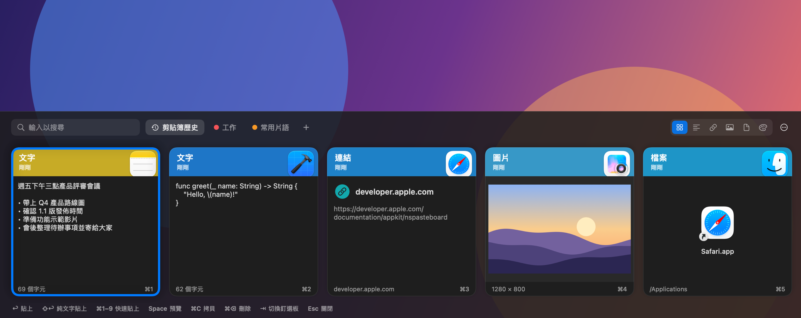
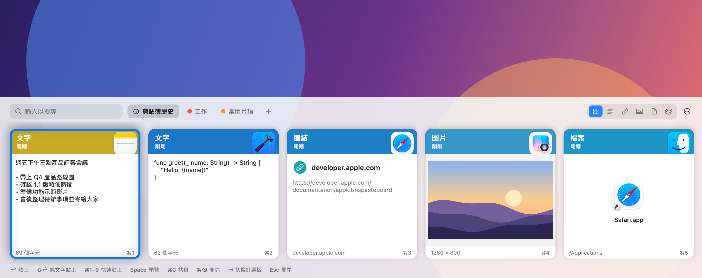
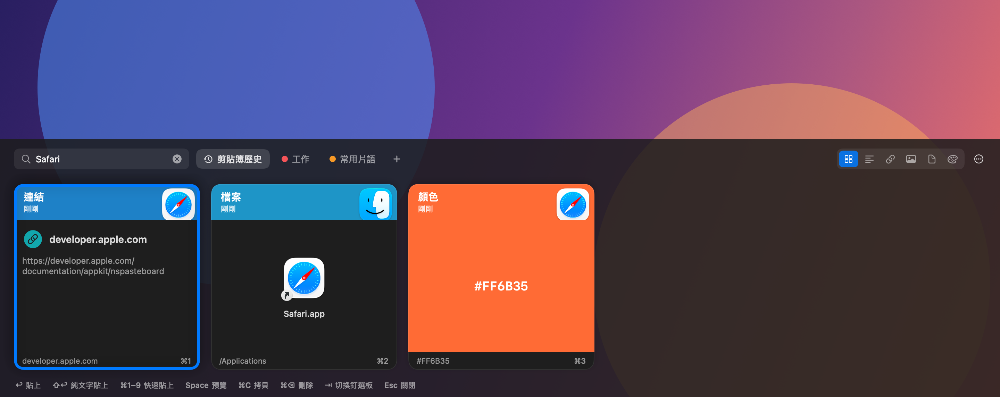
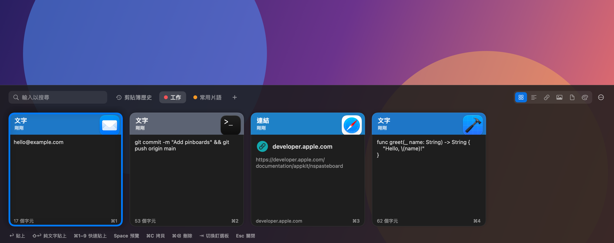
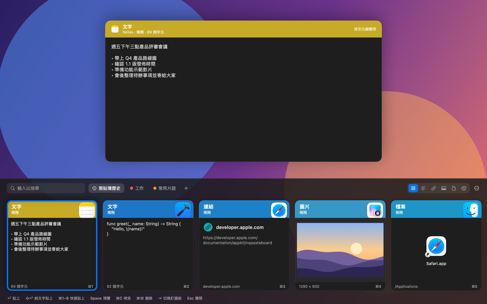
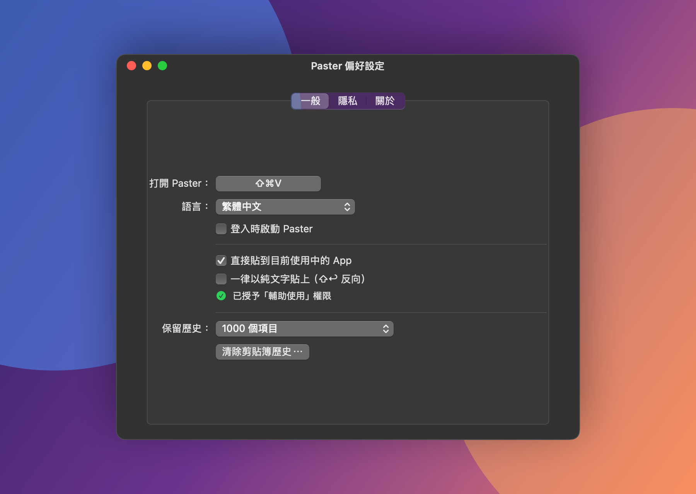
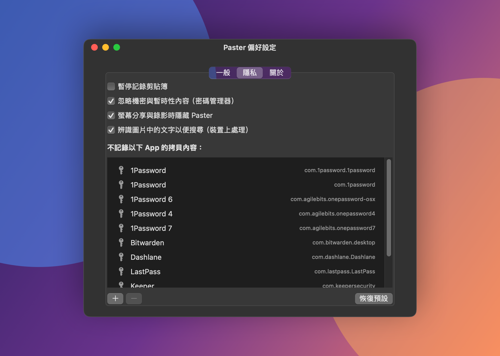

# Paster

Paster 是 macOS 上的剪貼簿管理工具。按下快捷鍵，螢幕底部就會滑出一排卡片，列出你最近拷貝過的內容；選一張，就會直接貼到目前使用中的 App。



## 目錄

- [截圖](#截圖)
- [功能](#功能)
- [安裝](#安裝)
- [使用方式](#使用方式)
- [快捷鍵](#快捷鍵)
- [偏好設定](#偏好設定)
- [隱私](#隱私)
- [從原始碼建置](#從原始碼建置)
- [尚未實作](#尚未實作)

## 截圖

### 主面板

每張卡片的頂部顏色取自來源 App 的圖示，並顯示類型、拷貝時間與字數（或圖片尺寸）。左下角標示 ⌘1–⌘9，可以直接快速貼上。支援深色與淺色模式。



### 搜尋

面板打開後直接打字就能搜尋，比對內容、來源 App、檔名，以及圖片中的文字。



### 釘選板

把常用的內容釘選到自訂的釘選板（例如「工作」、「常用片語」），用上方的分頁或 ⇥ 鍵切換。釘選的項目不受歷史上限和清除歷史影響。



### 預覽

選中卡片後按空白鍵，在面板上方顯示完整內容。



### 偏好設定

| 一般 | 隱私 |
|---|---|
|  |  |

## 功能

- **完整的剪貼簿歷史**：記錄文字、格式文字（RTF／HTML）、連結、圖片、檔案與顏色碼。重複拷貝相同內容時會合併成一筆並移到最前面。
- **底部卡片面板**：從螢幕底部滑出，霧面模糊背景，支援多螢幕（出現在滑鼠所在的螢幕）。
- **直接貼上**：選好項目後自動切回原本的 App 並貼上；也可以用純文字貼上，去掉格式。
- **搜尋與篩選**：即打即搜，也可以依類型（文字、連結、圖片、檔案、顏色）篩選。
- **圖片文字辨識**：在裝置上用 Vision 辨識圖片中的文字，讓截圖也能被搜尋到。
- **釘選板**：自訂多個釘選板，長期保存常用內容。
- **選單列圖示**：快速查看最近 10 個項目、暫停記錄、打開偏好設定。
- **介面語言**：English、繁體中文、简体中文（使用中國大陸用語，例如剪贴板、粘贴、偏好设置）。

## 安裝

1. 到 [Releases](../../releases) 下載 `Paster-<版本>.dmg`，或依照[從原始碼建置](#從原始碼建置)自行打包。
2. 打開 DMG，把 **Paster** 拖到「應用程式」資料夾。
3. 第一次打開：Paster 沒有 Apple 開發者簽名，macOS 會擋下它。請到「系統設定 → 隱私權與安全性」，往下捲到「安全性」，按「仍要打開」。或在終端機執行：
   ```sh
   xattr -dr com.apple.quarantine /Applications/Paster.app
   ```
4. 依提示到「系統設定 → 隱私權與安全性 → 輔助使用」打開 Paster。這是自動貼上所需要的權限；沒有開啟時，選擇項目只會拷貝到剪貼簿。

系統需求：macOS 13 Ventura 以上，支援 Apple 晶片與 Intel 處理器。

> **更新版本時**：因為沒有固定的開發者簽名，覆蓋安裝新版後「輔助使用」權限可能失效。請在設定中把 Paster 移除後重新加入。

## 使用方式

1. Paster 會在背景記錄你拷貝的內容，選單列會出現它的圖示。
2. 按 **⇧⌘V** 打開面板。
3. 用 **← →** 選擇卡片，按 **↩** 貼上；或直接按 **⌘1–⌘9** 貼上對應的卡片。
4. 在卡片上按右鍵，可以釘選到釘選板、以純文字貼上、打開連結、在 Finder 中顯示或刪除。
5. 按 **Esc** 或點面板以外的地方關閉。

## 快捷鍵

| 按鍵 | 動作 |
|---|---|
| ⇧⌘V | 打開／關閉面板（可在偏好設定修改） |
| ← → | 選擇上一張／下一張卡片 |
| ⌘← ⌘→ | 跳到第一張／最後一張 |
| ↩ | 貼上 |
| ⇧↩ | 以純文字貼上 |
| ⌘1–9 | 快速貼上第 1–9 張 |
| ⇧⌘1–9 | 以純文字快速貼上第 1–9 張 |
| 空白鍵 | 預覽（再按一次關閉） |
| ⌘C | 只拷貝，不貼上 |
| ⌘⌫ 或 ⌦ | 刪除 |
| ⇥ ／ ⇧⇥ | 切換到下一個／上一個釘選板 |
| ⌘N | 新增釘選板 |
| ⌘F 或直接打字 | 搜尋 |
| ⌘, | 偏好設定 |
| Esc | 依序：關閉預覽 → 清除搜尋 → 關閉面板 |

點兩下卡片也可以貼上。

## 偏好設定

**一般**
- 打開 Paster 的快捷鍵：點一下按鈕再按新的組合（至少包含 ⌘、⌥ 或 ⌃），按 Esc 取消，按 ⌫ 恢復成 ⇧⌘V。
- 語言：自動（跟隨系統）、English、繁體中文、简体中文，切換後重新啟動 Paster 生效。
- 登入時啟動 Paster。
- 直接貼到目前使用中的 App。
- 一律以純文字貼上（此時 ⇧↩ 反過來貼上原格式）。
- 保留歷史：100 到 10,000 個項目，或無限制；也可以清除剪貼簿歷史（釘選板會保留）。

**隱私**
- 暫停記錄剪貼簿。
- 忽略機密與暫時性內容。
- 螢幕分享與錄影時隱藏 Paster。
- 辨識圖片中的文字以便搜尋。
- 不記錄指定 App 的拷貝內容。

## 隱私

- 所有資料只存在本機的 `~/Library/Application Support/Paster/`（`history.json` 與 `blobs/` 資料夾），不會上傳到任何地方。
- 遵守 [nspasteboard.org](http://nspasteboard.org) 的機密與暫時性標記，密碼管理器拷貝的密碼不會被記錄。
- 預設不記錄以下 App 的內容：1Password、Bitwarden、Dashlane、LastPass、Keeper、密碼、鑰匙圈存取。
- 預設在螢幕分享和錄影時隱藏面板，避免剪貼簿內容外流。
- 圖片文字辨識完全在裝置上進行。

## 從原始碼建置

需要 Xcode 或 Command Line Tools（Swift 5.9 以上）。

```sh
./scripts/build_dmg.sh               # 產生 build/Paster.app 與 dist/Paster-1.0.0.dmg
VERSION=1.1.0 ./scripts/build_dmg.sh # 指定版本號
./scripts/screenshots.sh             # 用範例資料重新產生 docs/screenshots 的截圖
```

打包指令碼會編譯同時支援 Apple 晶片與 Intel 的版本、執行自我測試、產生圖示、以 ad-hoc 簽名，最後建立 DMG。

開發時常用：

```sh
swift build
PASTER_DATA_DIR=/tmp/paster-test .build/debug/Paster --self-test
PASTER_DATA_DIR=/tmp/paster-test .build/debug/Paster --snapshot /tmp/panel.png --scene strip
```

`--scene` 可用 `strip`、`search`、`pinboard`、`preview`、`prefs-general`、`prefs-privacy`，加上 `--light` 產生淺色模式。這兩個模式只使用 `PASTER_DATA_DIR` 指定的暫存資料，不會讀取你真正的剪貼簿歷史。

截圖中的內容都是範例資料。

## 尚未實作

- iCloud 同步
- 依序連續貼上（Paste Stack）
- 把卡片拖曳到其他 App
- 釘選板內拖曳排序
- AI 自動分類
